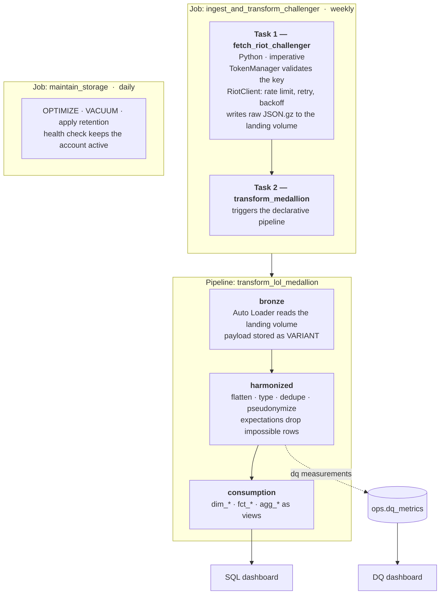

# Architecture overview

## Layers

The platform has **two materialized layers** and **one virtual layer**, plus an operational
schema. Layer boundaries are defined by *what is allowed to happen* at each one.

| Layer | Materialized | Mutability | What is allowed | What is forbidden |
|---|---|---|---|---|
| landing (`landing` volume) | files | append-only | write the HTTP response body, byte for byte | any parsing, any filtering |
| `bronze` | Delta tables | append-only | attach call metadata; extract the natural key for idempotency | typing, flattening, cleaning, deduplication of business content |
| `harmonized` | Delta tables | full or incremental refresh | flatten, type, deduplicate, pseudonymize, **drop impossible records**, derive attributes | business scope filtering, aggregation |
| `consumption` | **views** | n/a | business scope filtering, dimensional modeling, aggregation, metric definitions | anything that cannot be expressed as a query over `harmonized` |
| `ops` | Delta tables | append-only | data quality measurements | business data |

The rule that makes this work: **each layer may only do things its downstream consumer
cannot undo cheaply.** Dropping a record with `kills = -1` is safe because that record is
not recoverable information. Dropping remakes is *not* safe at the harmonized layer, because
"should remakes count?" is a question whose answer changes — so it lives in a view, where
changing it costs one `CREATE OR REPLACE VIEW`.

## End-to-end flow



### Why ingestion is imperative and transformation is declarative

Calling the Riot API requires a loop with state: pagination, a token bucket for the rate
limit, exponential backoff on HTTP 429, and a controlled exit on HTTP 403 when the key has
expired. A declarative pipeline cannot express that, and should not — it exists to define
tables, not to perform throttled I/O against a third party.

Everything downstream of the landing volume *is* a set of table definitions, which is exactly
what a declarative pipeline is for: dependency resolution, incremental processing,
expectations with per-rule failure counts, and lineage, all without hand-written plumbing.

See [ADR-0007](../adr/0007-declarative-pipeline-imperative-ingestion.md).

## Catalogs, schemas and volumes

```
mls              (catalog · prod target)        mls_dev          (catalog · dev target)
├── landing      VOLUME raw_riot                ├── landing      VOLUME raw_riot
├── bronze                                      ├── bronze
├── harmonized                                  ├── harmonized
├── consumption                                 ├── consumption
└── ops                                         └── ops
```

Both targets live in the **same workspace and the same metastore**. They are two deploy
variants of one Databricks Asset Bundle, not two environments. The `dev` target uses
`mode: development`, which prefixes resource names and pauses schedules automatically, and it
runs with a deliberately tiny scope (5 players, 1 match each).

The reason the separation exists at all is that **bronze is append-only**: a buggy ingestion
run cannot be undone by re-running it. Harmonized and consumption are refreshed, so they
self-heal and could safely share a schema — the isolation is there for the one layer that
cannot forgive a mistake.

See [ADR-0002](../adr/0002-single-workspace-two-bundle-targets.md).

## Resilience model

The Riot development key expires every 24 hours. A scheduled job that assumes a valid
credential will fail on most of its runs.

The platform treats credential availability as an expected input condition, not an error:

```
TokenManager.validate()
├── key present and accepted (HTTP 200 on a probe call)  → proceed
├── key absent from the secret scope                     → exit SKIPPED, record reason
└── key rejected (HTTP 401/403)                          → exit SKIPPED, record reason
```

A skipped run is a *successful* job execution that did no work. It does not page anyone, does
not show red in CI, and is recorded with its reason. The consequence is accepted: the history
will contain gaps on weeks where the key was not refreshed, and the backfill path — not the
incremental path — is the primary mechanism for accumulating history.

See [ADR-0001](../adr/0001-platform-databricks-free-edition.md) and the
[runbook](../operations/runbook.md#renewing-the-riot-api-key).

## Idempotency

Re-running ingestion for the same day must not duplicate data and must not re-spend API
requests unnecessarily.

| Stage | Mechanism |
|---|---|
| API → landing | file name is deterministic: `dt=<date>/<endpoint>/<natural_key>.json.gz`. An existing file is skipped before the HTTP call is made |
| landing → bronze | Auto Loader checkpoint; each file is processed exactly once. `meta_source_file` records provenance |
| bronze → harmonized | deduplication on the natural key, keeping the latest `meta_ingested_at` |
| harmonized → consumption | views — idempotent by construction |

The landing-zone skip is what protects the rate limit: a re-run of a partially failed
ingestion only fetches what is missing.

## Data quality

Quality is enforced at the bronze → harmonized boundary using the declarative pipeline's
native expectations, and measured into `ops.dq_metrics`.

| Expectation class | Action | Example |
|---|---|---|
| physically impossible value | **drop the row**, count the drop | `kills >= 0`; `champion_name IS NOT NULL` |
| structural invariant | **fail the pipeline** | a match must have exactly 10 participants |
| distributional warning | **warn only** | share of remakes above 25% in a run |

There is no quarantine table. Dropped records remain available in bronze in their original
form, so nothing is lost; what the drop removes is the risk of a corrupt value reaching an
average in the consumption layer. Business scope — remakes, queue type, game mode — is *not*
a quality concern and is never dropped; it is modelled as columns and filtered in views.

See [ADR-0008](../adr/0008-data-quality-strategy.md).

## Privacy

`puuid` is a stable, account-level identifier. It is required to crawl matches, and it must
never reach published output.

```
landing / bronze   puuid present, as received      (private workspace)
harmonized         player_sk = HMAC-SHA256(puuid, salt)   salt from the secret scope
consumption        aggregates only; no player-grain output is published
```

HMAC with a secret salt rather than a plain hash: a plain `SHA-256` of a known identifier
space is reversible by enumeration. The conversion lives in exactly one module, is unit
tested for stability, and the salt is asserted never to appear in logs.

See [ADR-0010](../adr/0010-puuid-pseudonymization.md).

## Observability

| Concern | Mechanism |
|---|---|
| job failure | native Databricks job notification, declared in the bundle |
| what happened during a run | structured stdout from the `Logger`, readable in the task log UI |
| data quality over time | `ops.dq_metrics` + a SQL dashboard: row counts, freshness, null rates, drop rates |
| lineage | Unity Catalog, populated automatically by the declarative pipeline |

There is intentionally no custom run-log or API-call-log table. Those were considered and
dropped: the platform already records run outcomes, and inventing audit tables that nobody
reads is worse than not having them.
