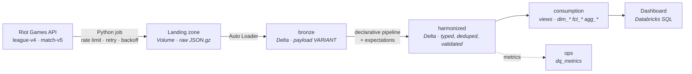

# mylolstats

A data platform built on **Databricks Free Edition** that ingests League of Legends match
data from the Riot Games API and turns it into high-elo meta analytics.

It is a portfolio project, but it is engineered as a deliverable: infrastructure as code,
CI/CD, data quality gates, pseudonymization of personal data, observability, and a written
record of every architectural decision.

## The thesis

Most data engineering portfolios implement the textbook medallion architecture:
three physical layers, bronze → silver → gold, each one materialized.

This project deliberately does something different, and the project's value is in arguing
why:

| | Textbook medallion | This project |
|---|---|---|
| Raw payload storage | typed columns parsed at ingestion, or JSON as `STRING` | `VARIANT` — schema-free, shredded, queryable |
| Physical layers | 3 (bronze, silver, gold) | **2** (bronze, harmonized) |
| Dimensional model | materialized gold tables | **views** over the harmonized layer |
| Why | convention | measured: 78k fact rows do not justify materialization |

The claim is not that three layers are wrong. The claim is that **the third layer should be
earned by a performance requirement, not assumed by convention** — and that at this data
volume, it is not earned. The dimensional model still exists, is still auditable, and still
demonstrates star-schema modeling. It simply costs no storage and no pipeline.

See [ADR-0006](adr/0006-two-physical-layers-virtual-consumption.md) for the full argument,
including the case against this decision.

## The business question

> **What does the meta look like at the very top of the Korean ladder, and how does it move
> between patches?**

KR Challenger is the leading indicator of the global League of Legends meta. The platform
answers, per patch and per lane: which champions are picked, banned and won with; how gold
and experience diverge by minute 15; and which objectives correlate with victory.

## Architecture at a glance

## Where to start reading

| If you want to know | Read |
|---|---|
| How the layers work and why | [Architecture overview](architecture/overview.md) |
| What is in each table | [Data model](architecture/data-model.md) |
| How the Python package is organized | [Code architecture](architecture/code-architecture.md) |
| Why each decision was made | [Decision records](adr/index.md) |
| How to run it from scratch | [Runbook](operations/runbook.md) |
| What is built and what is next | [Roadmap](project/roadmap.md) |

## Status and honesty notes

This project runs on the free tier of a commercial platform. Several design decisions exist
only because of that, and they are labelled as such rather than presented as universal best
practice. Equally, several platform capabilities are **assumed but not yet verified** — they
are tracked in the [feasibility validation plan](operations/validation-plan.md) and must be
proven before any code depends on them.

Riot Games is not affiliated with this project. It is non-commercial, uses only aggregated
published output, and exposes no player identifiers.
